# Hi, I'm Munhangyeol

---

## Summary

Backend Engineer interested in solving real-world problems around **performance, scalability, maintainability, and security**.

- Backend Engineer @ **SECUI** (Samsung SDS Affiliate)
- Experienced with **Spring Boot, Python, Redis, Celery, and Elasticsearch**
- Building **VulnTrace**, a vulnerability analysis and prioritization platform
- Interested in **Backend Systems, Security Engineering, and Infrastructure Automation**

**Tech Blog**  
https://velog.io/@msw0909/posts

**Email**  
mhg10181018@gmail.com

---

## Recent Technical Focus

### Backend Engineering

Recently focusing on strengthening backend fundamentals beyond feature implementation, with an emphasis on **code quality, maintainability, and design principles**.

- Exploring what **Pythonic Code** means in practice
- Improving Python code structure with readability, simplicity, and consistency in mind
- Applying **SOLID principles** in Java and Spring-based backend development
- Improving code structure through proper layering, dependency management, and interface-based design
- Focusing on backend services designed for long-term maintainability and scalability

---

### Security Engineering

Recently expanding my experience in **vulnerability analysis, dependency security, and software supply chain security**.

- Analyzing vulnerable packages, library dependencies, and their impact in real application environments
- Going beyond CVE detection to determine whether vulnerable libraries are **actually used by the application**
- Learning and applying **SBOM (Software Bill of Materials)** and software supply chain security concepts
- Matching software dependencies with vulnerability data using **OSV**
- Designing an **SCA (Software Composition Analysis)** workflow from dependency detection to vulnerability matching and source usage analysis
- Exploring **Reachability Analysis** to determine whether vulnerable code can actually be reached from application entry points
- Interested in **Risk-based Vulnerability Prioritization** based on severity, usage, reachability, and application context

Focus areas:

- Vulnerability Analysis
- Software Composition Analysis
- SBOM / Software Supply Chain Security
- Static Analysis
- Reachability Analysis
- Risk-based Vulnerability Prioritization

---

### Frontend Ecosystem

Expanding frontend knowledge while maintaining a backend-focused engineering perspective.

- Experienced with architectural differences between Vue 2 and Vue 3
- Working with **React + TypeScript**
- Understanding modern and legacy frontend build tools
  - **Vite** — Modern Dev Server / Build Pipeline
  - **Webpack** — Legacy Enterprise Build Systems
  - **Rollup** — Library / Plugin Bundling
- Building a broader understanding of frontend architecture and build pipelines beyond application code

---

### AI / Agent Workflow Automation

Exploring and applying **AI-assisted development workflows** using Claude and agent-based automation.

- Designed and maintained **Claude Skills** for reusable development workflows
- Built **agent-based automation flows** for coding, debugging, and analysis tasks
- Authored **CLAUDE.md** to standardize project context and development rules
- Applied AI to code generation, debugging, refactoring, and architecture design
- Improved AI development reliability by separating complex tasks into explicit phases with structured rules and context

Focus areas:

- AI-assisted Development Workflow
- Agent-based Coding Automation
- Prompt Engineering
- Context Engineering
- Human-in-the-loop Development

---

## Featured Project

### VulnTrace

**Vulnerability Analysis & Prioritization Platform**

VulnTrace aims to go beyond simply listing CVEs by determining whether vulnerable dependencies are **actually used**, **reachable**, and **worth prioritizing** in a real application.

- Designed as a **TypeScript-first Monorepo**
- Initial analysis target: **Java / Spring Boot / Maven**
- Maven dependency analysis and **CycloneDX SBOM** generation
- Vulnerability matching using **OSV**
- **React Dashboard / CLI Report**
- Expanding toward Source Usage, Reachability, and Risk Scoring analysis

**Tech Stack**  
`TypeScript` `React` `Fastify` `PostgreSQL` `Prisma` `CycloneDX` `OSV` `Maven`

Currently implemented through **Phase 3**.

For detailed architecture, implementation notes, and usage instructions, visit the repository below.

**Repository**  
https://github.com/Munhangyeol/vul-trace

---

## Education

**Sejong University** — Software Engineering  
(2019.03 ~ 2025.02)

**Samsung SSAFY 13th**  
(2025.01 ~ 2025.07)

---

## Open Source Contributions

### JabRef

Contributed to library stability, dependency compatibility, and version upgrades.

- [CSL Format Test Fix](https://github.com/JabRef/jabref/pull/13465)
- [Dependency Compatibility Fix](https://github.com/JabRef/jabref/pull/13511)
- [okhttp Version Upgrade](https://github.com/JabRef/jabref/pull/13521)

**Repository**  
https://github.com/JabRef/jabref

---

## PS (Problem Solving)

---

## Personal

